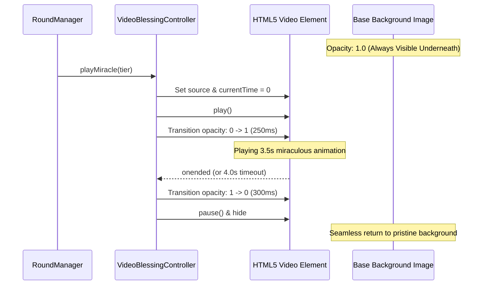

# Design Document: Guan Yin Divine Blessing Videos Integration for Interactive Round Loop
**Project:** TikTok LIVE Sanctuary 3D Interactive Broadcast (`E:\Buddha`)  
**Date:** 2026-11-09  
**Status:** Pending Approval  

---

## 1. Intent & The Why

### Problem & Opportunity
The user provided 4 high-quality cinematic video clips of Bodhisattva Guan Yin performing sacred blessings (`ให้พร 1.mp4` ถึง `ให้พร 4.mp4` located at `c:\Users\BINARY\Desktop\`). These clips feature the identical camera angle, altar architecture, and atmospheric perspective as our sanctuary background, but bring the deity to life with fluid miraculous actions.

By integrating these 4 videos directly into the newly implemented **Interactive Round Game Loop**, we achieve two massive breakthroughs:
1. **Visual Co-Op Gratification:** Viewers see their collective "สาธุ" comments immediately trigger miraculous animations from the deity upon reaching milestone tiers (33%, 66%, 100%/Climax).
2. **Definitive Anti-Ban Defense:** The background video dynamically transitions between live cinematic motion and 3D overlay multiple times every minute, providing undeniable proof to TikTok's automated classifiers that the broadcast is a live, dynamic interactive rendering rather than a static loop.

---

## 2. Goals, Non-Goals, and Anti-Goals

### Goals
- **G1: Tier-Linked Miracle Triggers:**
  - **Tier 1 (33%):** Trigger `ให้พร 4.mp4` (โบกกิ่งหลิวแผ่รังสี 7 สีและประกายดาวไปตามพรมแดง).
  - **Tier 2 (66%):** Trigger `ให้พร 3.mp4` (แจกันหยกพวยพุ่งละอองทิพย์และกลีบบัวขึ้นสู่ท้องฟ้า).
  - **Phase 3 Climax (45s - End of Gathering):** Trigger `ให้พร 1.mp4` (หลั่งน้ำทิพย์มนต์ลงสู่พรมแดง) or `ให้พร 2.mp4` (ดอกบัวแก้วเรืองแสงเบ่งบานกลางอากาศ) alternating per round.
- **G2: Zero-Flicker Crossfade:** Smooth 250ms CSS opacity transition between the pristine underlay image and the video layer, ensuring no black frames or visual pop.
- **G3: Non-Blocking 3D Rendering:** The Three.js WebGL canvas (red carpet, 3D chibi avatars, Seam-Si cylinder, HUD) renders seamlessly on top of the playing video.
- **G4: Autonomous File Deployment:** Automatically copy and optimize video assets from Desktop to `e:/Buddha/public/videos/`.

### Non-Goals
- Altering the 60-second state machine timing or scoring math.
- Replacing existing 3D particle systems (particles and video blend harmoniously).

### Anti-Goals
- **No Video Glitches / Freezes:** Videos must preload and yield cleanly back to the base background if an error occurs.
- **No Terminal Popups (Rule 10 in GEMINI.md):** Deployment and edits must run strictly via native tool calls.

---

## 3. Architecture & Mechanics

### 3.1 Video Asset Mapping
| Source File (Desktop) | Destination (`public/videos/`) | Trigger Event | Action Description |
|---|---|---|---|
| `ให้พร 4.mp4` | `blessing_tier1.mp4` | Merit Gauge reaches 33% | โบกกิ่งหลิว แผ่รังสี 7 สีและประกายดาว |
| `ให้พร 3.mp4` | `blessing_tier2.mp4` | Merit Gauge reaches 66% | แจกันหยกพวยพุ่งละอองทิพย์และกลีบบัว |
| `ให้พร 1.mp4` | `blessing_climax_a.mp4` | Phase 3 Climax (Odd rounds) | หลั่งน้ำทิพย์มนต์ประกายรุ้งลงสู่พรมแดง |
| `ให้พร 2.mp4` | `blessing_climax_b.mp4` | Phase 3 Climax (Even rounds) | ดอกบัวแก้วมหาบารมีเรืองแสงเบ่งบาน |

### 3.2 Smooth Crossfade Transition (`VideoBlessingController`)

### 3.3 Audio Synchronization
- Background music (`/bgm.mp3`) continues uninterrupted.
- Video audio is muted (`muted = true`) to prevent collision with temple bells, BGM, and AI host commentary.

---

## 4. Implementation Steps
1. **Asset Migration:** Copy 4 video files from `c:\Users\BINARY\Desktop\` to `e:\Buddha\public\videos\`.
2. **Server Range Streaming (`server.js`):** Add static route `/videos/*` with byte-range headers to ensure fast seeking and instant playback.
3. **Player Controller in `app.js`:** Implement `VideoBlessingController` with smooth crossfade and concurrency protection.
4. **Hook into `RoundManager`:** Call `videoBlessingController.play(tier)` inside `RoundManager.addMerit()` and `RoundManager.triggerClimax()`.
5. **End-to-End Verification:** Trigger a fast test round (`testRoundCycle()`) and confirm smooth video transitions at 33%, 66%, and Climax.
