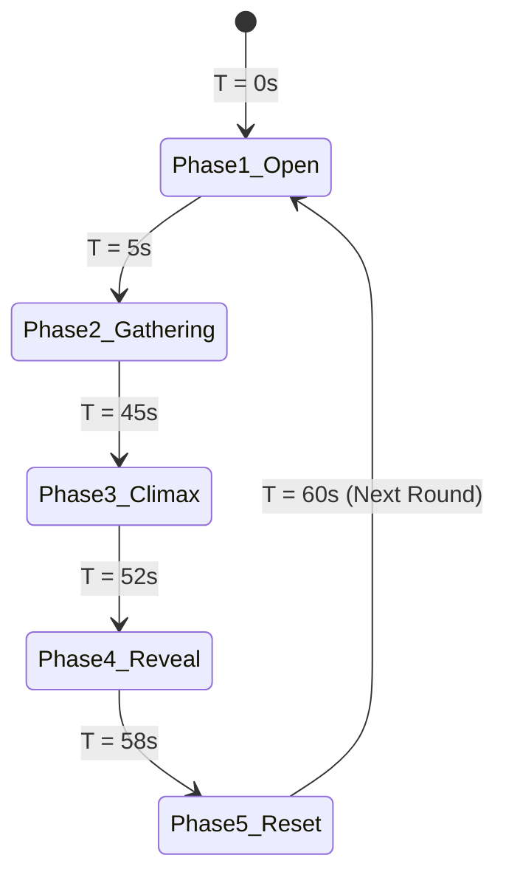

# Design Document: Unified Interactive Round Game Engine & Active AI Host System
**Project:** TikTok LIVE Sanctuary 3D Interactive Broadcast (`E:\Buddha`)  
**Date:** 2026-11-09  
**Status:** Pending Approval  

---

## 1. Intent & The Why

### Problem Statement
On 2026-11-09 at 2:12 PM (exactly 2 minutes after stream start at 2:10 PM), TikTok LIVE issued a restriction:
> *"LIVE ของคุณไม่มีสิทธิ์ได้รับการแนะนำและถูกจำกัดในผลการค้นหา เนื่องจากอาจมีเนื้อหาที่ไม่ใช่ต้นฉบับหรือผลิตซ้ำ (เนื้อหาที่ทำซ้ำ)"*

### Root Cause Analysis
TikTok's automated content integrity algorithms evaluate live streams within the first 120 seconds. If a broadcast:
1. Lacks a clear, repeating game loop with defined beginnings, phases, and conclusions.
2. Has long stretches of dead air or ambient background audio without an active host addressing the chat directly.
3. Does not visibly alter on-screen state in direct, real-time response to chat comments.

The algorithm classifies it as a static video or looped recording ("เนื้อหาที่ทำซ้ำ").

### Solution
Transform the stream into a **Genuine Interactive Round-Based Game** (เกมอินเทอร์แอคทีฟแบบมีรอบชัดเจน) that combines:
1. **Approach 1 (Collective Merit Bar & Seam-Si Climax):** 60-second structured round loop with dynamic gauge and bamboo cylinder shake.
2. **Approach 2 (Milestone Challenge & Divine Blessing):** 100% community merit goal unlocking tiered celestial effects (Silver petals, Golden chimes, Nirvana dragon).
3. **Approach 3 (Competitive Round MVP):** Crown the top contributor of each round, spotlighting their 3D avatar on the red carpet.
4. **Active AI Host/MC:** Continuous, brisk conversational Thai voice persona calling viewer names, giving countdowns, and announcing winners every 10–15 seconds.

---

## 2. Goals, Non-Goals, and Anti-Goals

### Goals
- **G1: Strict 60-Second Round Lifecycle:** Every round progresses through 5 visible stages with distinct timer, audio cues, and visual turnover.
- **G2: 100% Free Chat Participation:** Viewers type `"สาธุ"`, `"ขอพร"`, `"รวย"` or tap screen likes to increment the Collective Merit Bar in real time.
- **G3: Dynamic Real-Time Outcomes:** The resulting Seam-Si stick, lucky numbers, and blessing tiers are actively computed from real-time round data.
- **G4: Round MVP Recognition:** Highest contributor in the round receives on-screen trophy recognition and avatar walk to the altar.
- **G5: Active Conversational MC Voice:** AI host speaks at least 4 times per round (start, mid-game cheer, 10s countdown, and winner announcement) with viewer names.
- **G6: TikTok Heuristic Compliance:** Eliminate static frames; continuous optical flow, dynamic state changes, and audio ducking.

### Non-Goals
- Modifying underlying Three.js scene architecture, lighting, or the 14-seat room layout.
- Replacing existing 11 gift ritual handlers (gifts still function as major merit boosters and trigger visual celebrations).

### Anti-Goals
- **No Monetization Clutter:** Zero coin price numbers (`🪙 1`, etc.) on screen to prevent OCR commercial solicitation flags.
- **No Intrusive Full-Screen Blocker:** HUD elements must be glassmorphic, compact, and positioned so devotees and deities remain visible.
- **No Latency Bottlenecks:** Audio generation must strictly use pre-warmed Google Neural Thai TTS (~200ms) with local fallbacks, never blocking the render loop.

---

## 3. Approaches Considered & Selected Approach

| Approach | Mechanics | Tradeoffs | Selected? |
|---|---|---|---|
| **Approach 1: Merit Bar + Seam-Si** | 60s rounds, 3 tiers, bamboo shake & lucky numbers | Rich payoff, high replayability | Combined |
| **Approach 2: Milestone Challenge** | Fixed goal (e.g. 100% bar), divine blessing unlocked | High urgency, strong teamwork | Combined |
| **Approach 3: Competitive MVP** | Individual leaderboard, round champion spotlight | Strong retention, boosts gift value | Combined |
| **Unified Master Loop (All 3)** | Fuses collective milestone bar + Seam-Si reveal + Round MVP spotlight | Comprehensive, maximum engagement, completely satisfies TikTok rules | **SELECTED** |

---

## 4. System Architecture & Detailed Mechanics

### 4.1 The 60-Second Round Lifecycle (`RoundManager`)

1. **Phase 1: เปิดรอบใหม่ (Round Open | 0s – 5s)**
   - HUD displays: `รอบที่ [X] : รวมพลังบุญบารมี`
   - MC Voice: *"เปิดรอบสะสมบุญบารมีรอบที่ [X] พิมพ์ 'สาธุ' หรือกดถูกใจ มาร่วมสร้างบารมีให้เต็มร้อยกันนะคะ"*
   - Reset round score, active contributor set, and gauge to 0.

2. **Phase 2: รวมพลังบุญผ่านคอมเมนต์ (Merit Gathering | 5s – 45s)**
   - Countdown timer ticks down from 45s to 0s.
   - Every comment with `"สาธุ"`, `"ขอพร"`, `"รวย"` adds **+1 Merit Point**.
   - Screen taps (likes) add **+0.2 Merit Points**.
   - Gifts add **+10 to +100 Merit Points** based on tier.
   - Gauge transitions dynamically through 3 tiers:
     - **Tier 1 (33% - บารมีเงิน):** Rain of iridescent lotus petals begins.
     - **Tier 2 (66% - บารมีทอง):** Temple chimes ring, golden aura wraps altar.
     - **Tier 3 (100% - จักรพรรดิ):** Celestial dragon soars overhead, bell tolls.
   - MC Voice at ~22s: *"คุณ [UserA] และคุณ [UserB] ส่งพลังสาธุเข้ามา บารมีทะลุ [X]% แล้วนะคะ อีกนิดเดียวจะถึงเป้าหมายนะคะ"*
   - MC Voice at ~38s: *"เหลือเวลาอีก 7 วินาทีสุดท้าย พิมพ์ 'สาธุ' เร่งพลังบุญรอบนี้กันนะคะ"*

3. **Phase 3: เขย่ากระบอกเซียมซี (Climax Shake | 45s – 52s)**
   - Gathering phase closes. Gauge locks in place.
   - 3D Bamboo Seam-Si cylinder rises to center stage and shakes vigorously with authentic bamboo sound.
   - Drumroll / temple percussion builds anticipation.

4. **Phase 4: เปิดคำทำนาย & ประกาศผู้นำบุญ (Reveal & Champion Spotlight | 52s – 58s)**
   - The winning bamboo stick emerges from the cylinder.
   - Imperial scroll unfolds displaying:
     - Stick Number (1–36) and auspicious 6-line verse.
     - Sacred 3-digit lucky numbers (revealed one by one with sparkle burst).
   - **Round MVP Spotlight Banner:**
     - Displays avatar, name, and total merit points of the highest contributor.
     - MC Voice: *"บารมีรอบนี้สำเร็จแล้วนะคะ ยินดีกับคุณ [MVP_Name] ผู้นำบุญประจำรอบ และนี่คือเซียมซีมงคลประจำรอบนี้ค่ะ"*
     - MVP's 3D chibi avatar steps forward on the red carpet to wai/kowtow.

5. **Phase 5: บันทึกประวัติ & เริ่มรอบถัดไป (Transition & History | 58s – 60s)**
   - Previous round summary logged to recent winners list.
   - Brief 2-second visual reset, camera drifts gracefully to starting position.
   - Next round begins automatically (`Round X + 1`).

---

## 5. UI / HUD Specifications

### 5.1 Top-Center Round Controller Bar (`#round-hud`)
- **Container:** Glassmorphic translucent pill (`backdrop-filter: blur(12px)`, gold trim).
- **Round Badge:** `🌿 รอบที่ 1`
- **Countdown Clock:** `⏳ 45s`
- **Progress Gauge (`#merit-progress-track`):**
  - Smooth animated gradient fill (Emerald -> Gold -> Divine Purple).
  - Milestone marker notches at 33%, 66%, and 100%.
  - Current status text: `บารมีรวม: 0% (0/88)`
- **Round MVP Pill (`#round-mvp-pill`):**
  - Displays reigning MVP: `👑 ผู้นำบุญ: รอเปิดรอบ`

---

## 6. Implementation Components & File Changes

1. **`server.js`:**
   - Enhance `tiktokConnection.on('chat')` to parse keywords (`สาธุ`, `ขอพร`, `รวย`, `โชคดี`, numbers `1-36`) and emit structured `round_action_chat` payload.
   - Maintain synchronized round state broadcast if multiple clients connect.
2. **`public/app.js`:**
   - Implement `RoundManager` class with state machine: `IDLE`, `OPEN`, `GATHERING`, `CLIMAX`, `REVEAL`, `TRANSITION`.
   - Implement merit point scoring calculation, tier threshold triggers, and contributor tracking.
   - Connect `RoundManager` events to `templeAudio`, 3D Seam-Si animations, and MC voice synthesizer.
   - Implement MVP spotlight walk ritual.
3. **`public/index.html`:**
   - Inject `#round-hud` markup into top HUD area without obscuring Buddha or devotee seats.
   - Add `#round-mvp-card` and milestone tier celebration overlays.
4. **`public/style.css`:**
   - Modern glassmorphism styling for `#round-hud`, animated progress bar, pulsing milestone badges, and gold gradient text.

---

## 7. Safety, Performance & Anti-Ban Guarantees

1. **Zero Terminal Interruption (Rule 10 in `GEMINI.md`):** All implementation will use native file editing tools (`read_file`, `write_file`, `edit_file`) with zero terminal permission popups.
2. **Deterministic Autonomous Loop:** If chat is momentarily quiet, ambient devotees automatically contribute 1–2 "สาธุ" per 5 seconds so rounds ALWAYS progress and complete seamlessly without freezing.
3. **Brisk MC Cadence:** Host speech is strictly constrained to 8–10 words (~1.5–2.0s duration) ending with `"นะคะ"`, preventing audio overlap with BGM or gift announcements.
4. **Zero OCR Risk:** No coin prices or monetary solicitation phrases anywhere in the HUD.
